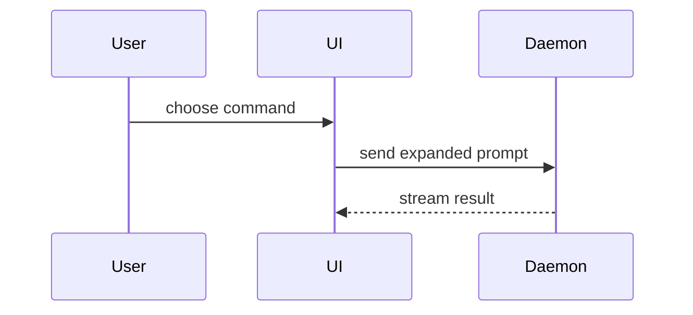

This skill writes the PR body only. It does not push a branch, open the PR, or decide what goes into it. See [CREDITS.md](CREDITS.md).

**Domain language.** Check `.ab-method/structure/index.yaml` for where `UBIQUITOUS_LANGUAGE.md` and `CONTEXT.md` live and use their terms. Look for the index under the project root first; only if the project has none (plugin install), read the bundled default at `../../../.ab-method/structure/index.yaml` relative to this `SKILL.md`. Every path it names is relative to the project root.

**Repo template.** If the repo has `.github/pull_request_template.md`, fill that template and put Summary, Evidence and Merge Danger under it.

Use this template for writing the PR body:

```markdown
## Summary

<diagram, diff-sketch, or tree>

## Evidence

- **Before:** <screenshot/output/failing test run>
  **After:** <screenshot/output/passing test run>

## Merge Danger

**Door:** <one-way or two-way>

<optional: description>

**Blast Radius:** <one-word description>

<optional: potential ramifications of merge>
```

## Inside an AB Method task

Fill the sections from what the task already produced:

- **Summary** starts from `docs/tasks/<task>/change-map.md` `## Actual`, trimmed to the view that makes the key point.
- **Evidence** comes from the tracker's `## Protected` section: each protected use case's forced red, then green. Add the red/green of any `verify: repro` mission (the bug's failing test before the fix).
- **Merge Danger** consults `docs/adr/` and `docs/seams/`. A changed seam interface, a seam still `migrating`, a schema migration, or anything an ADR calls hard to reverse is a likely one-way door or a wide blast radius.

## Sections

Skip all preambles and keep prose brief.

### Summary

Pick the smallest view that makes the key point clear.

- Show logic or an algorithm as pseudocode:

```text
on(save)
  if content is unchanged
    return cached result
  write new content
  return fresh result
```

- Show runtime control flow as a call tree:

```text
submitForm
  createSession
    persistPrompt
    launchAgent
  navigateToSession
```

- Show UI structure as a component tree, including state and module boundaries that matter:

```text
<SessionPage> (apps/example/src/routes/session.tsx)
  useSessionEvents()
  <SessionToolbar>
    <RunSkillButton> (packages/ui)
```

- Show file responsibility or a broad refactor as a shallow file tree:

```text
src/
├── commands/       # parses user actions
├── sessions/       # owns session state
└── transport/      # sends API requests
```

- Show component interaction, control flow, or data flow with Mermaid:



- Use `diff` when the point is what changes and the surrounding shape already exists. Match the diff shape to the topic.

For a component change:

```diff
 <SessionPage>
   useSessionEvents()
   <SessionToolbar>
+    <RunSkillButton />
   <SessionTimeline>
+    <SkillResultCard />
```

For a file-layout change:

```diff
 src/
 ├── commands/
+│   └── show-me.ts       # expands the slash command
 ├── sessions/
-└── transport.ts
+└── transport/
+    ├── client.ts
+    └── stream.ts
```

For a call-tree or call-stack change:

```diff
 submitForm
   createSession
     persistPrompt
+    expandSkillMention
     launchAgent
-  navigateToSession
+  navigateToSession
+    subscribeToEvents
```

For a state or control-flow change:

```diff
 on(save)
-  write content
+  if content is unchanged
+    return cached result
+  write new content
+  invalidate cache
```

- Show the whole block when most of it is new, when omitted context would hide ownership or order, or when the user needs a copyable target shape:

```ts
function expandSkill(command: string): string {
  const skillName = command.slice(1);
  return `use the ${skillName} skill`;
}
```

#### Guidance

Place each visual next to the short text it supports. Keep only the calls, files, props, states, and boundaries needed to answer the reviewer's question.

You may use one of these, you may use several, it is unlikely you will use all of them. Use your judgement and don't overwhelm the reader.

### Evidence

Concrete evidence that the change works. Show a before and after.

Screenshots are S-tier — when the environment is set up for it and the change is visual.

Execution-based evidence is A-tier. Test results, console output. Show the exact test that now fails and passes, using pseudocode. "Tests are green" on its own is a claim, not a before and after.

### Merge Danger

Describe whether it's a one-way or two-way door. You can walk back through two-way doors, but not one-way doors. A PR that is cheap to roll back is lower risk. Changes that involve destructive actions or hard-to-reverse decisions are one-way doors. Rolling back a commit won't unsend an email or un-migrate a write.

The blast radius is the potential impact or scope of the changes introduced by this PR. Consider all possibilities. Examples are layout shift, breakages for consumers, mobile responsiveness, callers of a seam.
