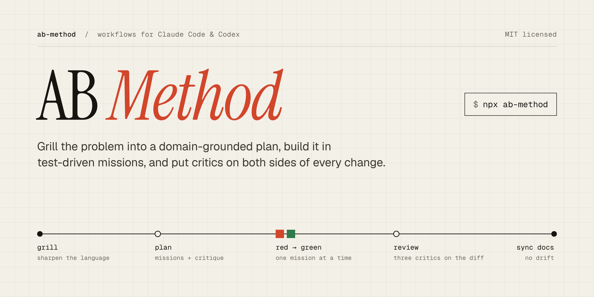

# AB Method



A workflow system for Claude Code and Codex. It grills a problem into a domain-grounded plan, then either drives it through test-driven missions you review one at a time, or hands it to an autonomous `/goal` loop that runs to a verifiable stop condition.

## Install

```bash
npx ab-method
```

The installer detects `.claude/` and/or `.agents/` and installs slash commands and skills for Claude Code, Codex, or both (it asks if neither exists). It also adds `.ab-method/` (workflow definitions and the path index), `docs/` scaffolding, `AGENTS.md` for Codex, and optional subagents for Claude Code.

### Or as a plugin

Nothing is copied into your project; the plugin updates on its own.

```bash
# Claude Code
/plugin marketplace add ayoubben18/ab-method
/plugin install ab-method@ab-method

# Codex
codex plugin marketplace add ayoubben18/ab-method
codex plugin add ab-method@ab-method
```

Skills are namespaced `ab-method:<name>`: run `/ab-method:ab-create-task` (Claude Code) or `$ab-method:ab-create-task` (Codex), or describe what you want. A project's own `.ab-method/structure/index.yaml` overrides the bundled one. The plugin ships no slash commands or subagents. Don't combine it with `npx ab-method` in one project, or every workflow shows up twice.

## Commands

On Claude Code, run a workflow as a slash command. Codex has no shared slash commands, so use the matching skill (`$ab-create-task`) or describe your intent.

| Command | Purpose |
|---|---|
| `/mastermind` | Entry point: routes your intent to the right workflow |
| `/create-task` | Grill a problem into a task with test-driven missions |
| `/resume-task` | Continue a task from its progress tracker |
| `/start-task` | Run a task autonomously, one subagent and one commit per mission |
| `/extend-task` | Add missions to an existing task |
| `/create-task-from-handoff` | Turn a tangent parked mid-grill into a task |
| `/create-goal` | Write a prompt for an autonomous `/goal` loop |
| `/extend-goal` | Extend a goal from what its run built |
| `/create-roadmap` | Split a bigger idea into a dependency-ordered graph of tasks |
| `/start-roadmap` | Run a planned roadmap in dependency order |
| `/test-mission` | Add tests to code that wasn't written test-first |
| `/analyze-project` | Document domain, tech stack and patterns (`/analyze-frontend`, `/analyze-backend` for one side) |
| `/update-architecture` | Refresh architecture and domain docs |
| `/ab-cleanup` | Compact docs to budget and remove task leftovers; also the 3.x → 4.0 migration |
| `/ab-master [name]` | List workflows, or run one by name |

**Task, goal or roadmap?** A task keeps you in the loop mission by mission. A goal is one objective with a checkable stop condition, run unattended. A roadmap is several ordered tasks; it can leave open decisions and uncharted areas for later.

## How it works

1. **Always grill.** Every task and goal starts with `grill-with-docs`, which checks your terms against `UBIQUITOUS_LANGUAGE.md` and `CONTEXT.md` and records decisions as ADRs.
2. **Plan before code.** Each task gets a test plan, a placement decision per capability (reuse, extend or extract), and, for new UI, a throwaway HTML prototype with several variants to pick from.
3. **Test what matters.** `verify: test` missions run through the `tdd` skill; `verify: build` missions (styling, wiring, config) rely on typecheck, build and the existing suite.
4. **Critics on both sides.** `critique-plan` checks the plan against the domain model before coding; `review-implementation` and `sync-architecture` check the diff and the docs after. They stay silent unless there is a real problem.
5. **Measure the blast radius.** `change-map` predicts which modules a task will touch, then compares that with the real diff.
6. **Park, don't guess.** A question nobody can answer yet goes in `unresolved-questions.md` with a placeholder behind one seam (`TODO(UQ-n)`); a tangent becomes a handoff.
7. **Small docs.** Domain and architecture docs have word budgets, hold only current state, and are checked by `npx ab-method check-docs`.
8. **Parallel only when you agree.** Missions and roadmap tasks run sequentially unless you allow tagging them for parallel subagents.

## File layout

```
.ab-method/
  core/                  Workflow definitions
  rules/                 Communication, code and docs rules for every workflow
  structure/index.yaml   Paths, outputs and doc budgets (all configurable)

UBIQUITOUS_LANGUAGE.md   Domain glossary
CONTEXT.md               Bounded-context overview

docs/
  architecture/          tech-stack.md, frontend/ and backend/ pattern topics
  adr/                   Decision records
  tasks/<task>/          progress-tracker.md, change-map.md, review.md, ...
  goals/<goal>/          goal.md + progress-tracker.md
  handoffs/              Tangents awaiting their own task
```

## Upgrading to 4.0

Existing trackers keep working. After updating, run `/ab-cleanup` once: on its own branch it migrates `index.yaml`, splits pattern docs into topics, compacts oversized docs (listing what it drops), and, with your approval, removes leftovers from completed tasks.

## Contributing

See [CONTRIBUTING.md](CONTRIBUTING.md) for developing the plugin.
